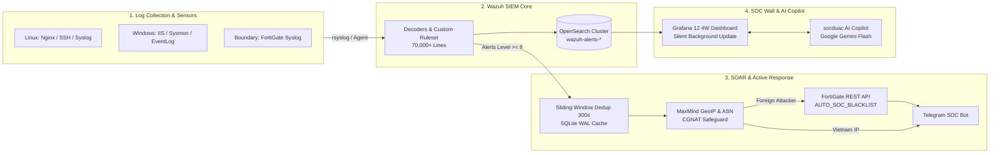

# 🛡️ Enterprise Wazuh SIEM, SOAR Automation & AI Copilot Platform

[](https://wazuh.com/)
[](https://grafana.com/)
[](https://fortinet.com/)
[](https://ai.google.dev/)
[](https://attack.mitre.org/)
[](https://opensource.org/licenses/MIT)

> **Hệ sinh thái Giám sát An toàn Thông tin (SIEM), Tự động hóa Phản ứng Biên (SOAR), Trực quan hóa Mission Control và Trợ lý ảo AI Copilot cấp Doanh nghiệp.**  
> Dự án được thiết kế cho quy mô hạ tầng lớn (hàng triệu tệp tin, đa nền tảng Linux & Windows Server, cụm tường lửa FortiGate), giải quyết triệt để các bài toán thực chiến: **chống nghẽn cảnh báo (Alert Fatigue), bảo vệ dải IP 4G/CGNAT nội địa, tối ưu FIM Rule 233 và tích hợp LLM hỗ trợ tác chiến an ninh mạng.**

---

## 📑 MỤC LỤC
1. [Kiến Trúc Tổng Thể](#-kiến-trúc-tổng-thể)
2. [Điểm Sáng Công Nghệ & Khác Biệt Thực Chiến](#-điểm-sáng-công-nghệ--khác-biệt-thực-chiến)
3. [Ma Trận Phân Loại Đe Dọa (CAT1 - CAT6)](#-ma-trận-phân-loại-đe-dọa-cat1---cat6)
4. [Cấu Trúc Thư Mục Repository](#-cấu-trúc-thư-mục-repository)
5. [Hướng Dẫn Triển Khai & Khởi Chạy](#-hướng-dẫn-triển-khai--khởi-chạy)
6. [Bản Quyền](#-bản-quyền)

---

## 🏛️ KIẾN TRÚC TỔNG THỂ

Hệ thống hoạt động theo mô hình phòng thủ 4 lớp khép kín:



---

## 💎 ĐIỂM SÁNG CÔNG NGHỆ & KHÁC BIỆT THỰC CHIẾN

### 1. Thuật toán Khử Trùng Lặp Cửa Sổ Trượt (Sliding Window Deduplication 300s)
* **Vấn đề:** Khi kẻ tấn công brute-force SSH hoặc flood HTTP hàng nghìn request/phút, SIEM sinh bão cảnh báo (Alert Fatigue), làm nghẽn hàng đợi webhook và quá tải API thiết bị mạng.
* **Giải pháp:** Sử dụng SQLite chế độ WAL (Write-Ahead Logging) theo dõi cặp khóa `(src_ip, rule_id)` trong cửa sổ 5 phút. Alert đầu tiên được chuyển đi ngay để cấm biên; các alert tiếp theo chỉ tăng bộ đếm tần suất (`count += 1`), triệt tiêu hơn 95% tải thừa.

### 2. Bộ Lọc Bảo Vệ IP Nội Địa (CGNAT Safeguard)
* **Vấn đề:** Các nhà mạng di động 4G tại Việt Nam dùng chung dải CGNAT (hàng ngàn người chung 1 IP public). Nếu tự động cấm IP này tại tường lửa biên, hàng ngàn người dùng vô tội sẽ bị mất mạng oan (DoS diện rộng).
* **Giải pháp:** Tích hợp MaxMind GeoLite2 ASN & Country. **100% IP nước ngoài** bị chặn biên tự động; **IP Việt Nam** chuyển sang luồng Human-in-the-Loop (HITL) qua Telegram để kỹ sư xác minh.

### 3. FIM Phân Tầng Chọn Lọc (Tiered Integrity - Vượt ngưỡng Rule 233)
* **Vấn đề:** Wazuh mặc định giới hạn 100.000 file trong Syscheck database. Quét toàn bộ Web Root WordPress/Drupal sẽ làm Agent chạm ngưỡng Rule 233 và treo máy.
* **Giải pháp:** Dùng thuộc tính `restrict` chỉ theo dõi các định dạng thực thi nguy hiểm (`.php`, `.aspx`, `.jsp`, `.dll`, `.sh`) và đưa thư mục dữ liệu tĩnh (`uploads/`, `cache/`) vào `<ignore>`, giảm từ 1.000.000 file xuống dưới 5.000 file trọng yếu.

### 4. Động cơ Cập Nhật Ngầm Không Chớp Màn Hình (Silent Background Update)
* **Vấn đề:** Trên màn hình lớn SOC Wall, Dashboard auto-refresh mỗi phút làm các panel chớp nháy, hiện loading bar giật cục.
* **Giải pháp:** Ứng dụng mô hình **Stale-While-Revalidate**: Khóa cứng bố cục layout, ẩn toàn bộ progress bar xoay tròn, áp dụng CSS fade 0.3s khi số liệu mới cập nhật, tạo trải nghiệm tĩnh lặng, chuyên nghiệp.

### 5. Trợ Lý Ảo AI Tác Chiến (socduac AI Copilot)
* **Tích hợp:** Google Gemini 3.5 Flash / Flash Lite đàm thoại tự nhiên đa lượt ngay trong giao diện giám sát.
* **Nguyên tắc an toàn (Guardrails):** **Strict Read-Only & Zero-Mutation** (AI chỉ cố vấn tham mưu, tuyệt đối không tự ý sửa/xóa log hay can thiệp hệ thống) kết hợp **On-Demand Token Saver**.

---

## 📊 MA TRẬN PHÂN LOẠI ĐE DỌA (CAT1 - CAT6)

| Mã | Nhóm Đe Dọa | Kỹ thuật Điển hình | Mức Độ | Phản Ứng SOAR / Tường Lửa |
|:---:|:---|:---|:---:|:---|
| **CAT1** | **Web Application Exploit** | SQL Injection, XSS, RCE, Webshell Injection | **10 - 14** | Chặn vĩnh viễn (`Permanent Drop`) tại FortiGate |
| **CAT2** | **Credential Access & Brute-Force** | Dò quét mật khẩu SSH port 22, RDP 3389, FTP, wp-login | **6 - 10** | Chặn tạm thời (`Temporary Ban 1h - 24h`) |
| **CAT3** | **Denial of Service (DoS / DDoS)** | HTTP Request Flooding, Slowloris, SYN Flood | **8 - 12** | Kích hoạt rate-limiting WAF, cách ly IP tại Policy |
| **CAT4** | **Host Compromise & Persistence** | Thay đổi file hệ thống, SEO Cloaking cờ bạc lậu, DLL injection | **12 - 15** | Báo động đỏ Telegram, cách ly máy chủ (`Host Isolation`) |
| **CAT5** | **Reconnaissance & Scanning** | Masscan, Nmap, Nikto, Nuclei, Acunetix, sqlmap | **6 - 8** | Ghi nhận Watchlist, bẫy Honeypot |
| **CAT6** | **Network & Perimeter Threat** | Quét cổng VPN/IPSec, vi phạm Access Policy FortiGate | **7 - 10** | Cấm biên tức thì tại Firewall Policy |

---

## 📁 CẤU TRÚC THƯ MỤC REPOSITORY

```text
enterprise-wazuh-soc-soar/
├── README.md                          # Tài liệu tổng quan dự án
├── .gitignore                         # Loại bỏ mật khẩu, token, cache, db
├── .env.example                       # Mẫu cấu hình biến môi trường an toàn
├── docs/                              # Tài liệu kỹ thuật chuyên sâu
│   ├── architecture_design.md         # Thiết kế kiến trúc 4 lớp chi tiết
│   ├── threat_taxonomy_matrix.md      # Bảng phân loại đe dọa CAT1-CAT6
│   └── learn.md                       # Cẩm nang vận hành & kiến trúc toàn diện
├── detection_rules/                   # Module Luật phát hiện (Detection Engineering)
│   └── local_rules.xml                # Tập luật tùy biến phát hiện SQLi, XSS, RCE, Cloaking
├── soar_automation/                   # Module Tự động hóa Phản ứng (SOAR)
│   └── shuffle_active_response.py     # Script khử trùng lặp & gọi API FortiGate
├── visualization_grafana/             # Module Trực quan hóa (Mission Control)
│   ├── soc_ultimate_4w_dashboard.json # File JSON Dashboard 28 panels chuẩn 4W
│   └── silent_background_update.css   # CSS Anti-Flicker triệt tiêu chớp nháy màn hình
├── ai_soc_copilot/                    # Module Trợ lý ảo AI (LLM Ops & Security)
│   ├── copilot_server.py              # Backend FastAPI tích hợp Gemini đa lượt
│   ├── widget_frontend.js             # Giao diện ChatBotDUAC nổi trên Grafana
│   └── guardrails.md                  # Quy chuẩn an toàn Strict Read-Only
└── deploy_automation/                 # Module Tự động hóa Triển khai
    ├── deploy_wazuh_agent.sh          # Script cài đặt Agent tự động
    └── playbooks/                     # Ansible Playbooks quét webshell & kiểm toán
```

---

## 🚀 HƯỚNG DẪN TRIỂN KHAI & KHỞI CHẠY

### 1. Yêu cầu hệ thống
* Hệ điều hành: Ubuntu 22.04 / 24.04 LTS hoặc RHEL 8 / 9.
* Wazuh Manager v4.9+ & OpenSearch / Wazuh Indexer.
* Grafana v11+ hoặc v12+.
* Python 3.10+ (thư viện: `requests`, `fastapi`, `uvicorn`, `maxminddb`).

### 2. Các bước cấu hình nhanh
```bash
# 1. Clone repository
git clone https://github.com/your-username/enterprise-wazuh-soc-soar.git
cd enterprise-wazuh-soc-soar

# 2. Cấu hình biến môi trường
cp .env.example .env
nano .env

# 3. Nạp luật phát hiện vào Wazuh Manager
cp detection_rules/local_rules.xml /var/ossec/etc/rules/
/var/ossec/bin/wazuh-control restart

# 4. Cài đặt kịch bản tự động phản ứng SOAR
cp soar_automation/shuffle_active_response.py /var/ossec/integrations/shuffle.py
chmod 750 /var/ossec/integrations/shuffle.py
chown root:wazuh /var/ossec/integrations/shuffle.py

# 5. Khởi chạy AI SOC Copilot
cd ai_soc_copilot
pip install -r requirements.txt
python3 copilot_server.py
```

---

## 📄 BẢN QUYỀN
Phát hành theo giấy phép [MIT License](LICENSE).

