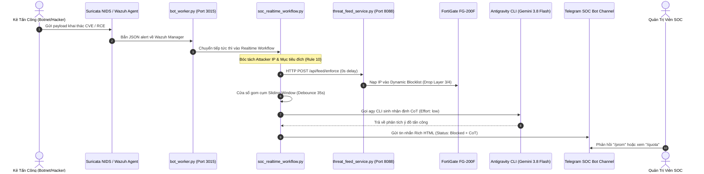

# KIẾN TRÚC TOÀN DIỆN VÀ ĐẶC TẢ KỸ THUẬT: VNU TRUE AGENTIC AI SOC & SOAR

> **Phiên bản:** v2.6 Enterprise Edition (Tích hợp Google Antigravity Core & Gemini 3.8 Flash Pro)  
> **Cập nhật:** 2026-10-28  
> **Tài liệu dành cho:** Quản trị viên An ninh Mạng, Kỹ sư Điều hành SOC & Chuyên gia Tự động hóa SOAR.

---

## 1. TỔNG QUAN KIẾN TRÚC & NGUYÊN LÝ HOẠT ĐỘNG (ARCHITECTURAL OVERVIEW)

Hệ thống **VNU Agentic AI SOC** được xây dựng trên nguyên tắc **Tự động hóa tác chiến 2 lớp (Dual-Layer Defense)** kết hợp **Suy luận Ngữ cảnh thời gian thực (Real-time In-Context Reasoning)**:

1. **Không sử dụng kịch bản tĩnh (Hardcoded Response)**: Mọi nhận định về đợt tấn công, mức độ rủi ro, phân loại chiến dịch (Botnet dò quét diện rộng vs APT có chủ đích) đều được kích hoạt thông qua mô hình **Gemini 3.8 Flash** của tài khoản **Google AI Pro** qua bộ công cụ **Google Antigravity CLI chính thức (`agy` v1.4.8)**.
2. **Deterministic SOAR song hành Agentic AI**:
   - Các hành động khẩn cấp (Khóa IP tấn công, diệt tiến trình độc hại) được **tự động thực thi ngay lập tức (100% Autonomous)** qua Tường lửa Biên FortiGate (Cổng 8088) và Host Active Response (Wazuh Agent).
   - Agentic AI đóng vai trò **Bộ não Điều tra (Investigative Brain)**: tổng hợp chuỗi sự kiện, gom nhóm dữ liệu trong khung thời gian trượt, phân tích ý đồ kẻ tấn công và xuất báo cáo trực quan cho Quản trị viên qua Telegram và Grafana.
   - Các can thiệp có rủi ro cao (Vá mã nguồn ứng dụng, sửa file code Classic ASP / PHP) được quản lý qua cơ chế **Human-in-the-Loop (HITL)** với mã đề xuất `PROP-YYYYMMDD-XXX`.

---

## 2. BẢN ĐỒ THÀNH PHẦN, FILE NGUỒN & DỊCH VỤ THỰC THI (SYSTEM BLUEPRINT)

```
/var/ossec/
├── tele_alerts/web_soc/
│   └── bot_worker.py                 # [DAEMON] Dịch vụ wazuh-keycloak-tele-alert.service
│
├── tools/ (Đồng bộ: enterprise-wazuh-soc-soar/ai_soc_copilot/)
│   ├── soc_realtime_workflow.py      # [CORE] Bộ điều phối Real-time Event Workflow (Debounce 35s)
│   ├── soc_agentic_scheduler.py      # [CRON */20m] Săn tìm và xâu chuỗi Cyber Kill Chain (+/- 30m)
│   ├── cluster_health_sentinel.py    # [CRON */10m] Giám sát tài nguyên 3 Node & Dual Quota Antigravity
│   ├── agentic_threat_hunter.py      # [TELEMETRY] Query OpenSearch Indexer (10.241.1.30:9200)
│   ├── soc_ai_reasoning_engine.py    # [AI BRAIN] Cầu nối Antigravity CLI & Google Cloud Code Quota Sync
│   ├── soc_action_dispatcher.py      # [SOAR AR] Dispatcher gửi lệnh FortiGate (:8088) & Host AR (:1514)
│   ├── threat_feed_service.py        # [PERIMETER GW] Daemon chạy cổng 8088 cấp Feed cho FortiGate FG-200F
│   └── socduac/
│       └── socduac_server.py         # [METRICS API] FastAPI (Port 8090) xuất Prometheus cho Grafana
│
└── soc_daily_reports/
    ├── ai_token_metrics.json         # Lịch sử tiêu thụ Token, Latency, Rate Spike
    ├── antigravity_quota_state.json  # Bộ nhớ trạng thái Quota 5h/Tuần & Đếm ngược Reset Time
    └── investigations.json           # Sổ bộ 50 cuộc điều tra Threat Hunting gần nhất
```

---

## 3. CƠ CHẾ GỌI ANTIGRAVITY CLI (`agy`) VÀ MÔ HÌNH GEMINI 3.8 FLASH

Rất nhiều kỹ sư thắc mắc: *Hệ thống gọi Model AI ở đâu? Dòng code nào? Truyền tham số gì? Cơ chế xác thực ra sao?*

### 3.1. Điểm Thực Thi Cốt Lõi: Hàm `call_antigravity_cli`
- **File**: [`/var/ossec/tools/soc_ai_reasoning_engine.py`](file:///var/ossec/tools/soc_ai_reasoning_engine.py#L414-L456)
- **Dòng code**: 414 - 456
- **Mã nguồn thực tế**:
```python
def call_antigravity_cli(prompt: str, effort: str = None, timeout_sec: int = 30, subagent: str = "Copilot Reasoning") -> str:
    agy_bin = "/usr/local/bin/agy"
    eff = effort or CURRENT_EFFORT_MODE  # "low" (Turbo) hoặc "medium" (Deep)
    cmd = [
        agy_bin,
        "-p", prompt,
        "--effort", eff,
        "--output-format", "json",
        "--disable-slash-commands",
        "--dangerously-skip-permissions"
    ]
    res = subprocess.run(cmd, capture_output=True, text=True, timeout=timeout_sec, cwd="/var/ossec")
    if res.returncode == 0 and res.stdout.strip():
        j = json.loads(res.stdout.strip())
        text_response = j.get("response", "")
        usage = j.get("usage", {})
        # Ghi nhận token metrics
        record_ai_token_usage(usage, duration, subagent=subagent, prompt_snippet=prompt)
        return format_telegram_html(text_response)
```

### 3.2. Ý Nghĩa Của Các Cờ Tham Số Khi Gọi Antigravity:
1. `-p "<prompt>"`: Chạy chế độ non-interactive (không mở giao diện TUI interactive), phù hợp hoàn toàn cho daemon ngầm và crontab.
2. `--effort <low|medium>`:
   - `--effort low` (**Turbo Mode**): Phản hồi siêu nhanh (3-4 giây), tiết kiệm token tối đa, dùng cho Event Triage và tổng hợp 20 phút.
   - `--effort medium` (**Deep Reasoning Mode**): Suy luận đa bước Chain of Thought (CoT), dùng cho Code Audit và phân tích chuỗi tấn công APT.
3. `--output-format json`: Trả về cấu trúc JSON chuẩn gồm cả phản hồi nghiệp vụ `response` và dữ liệu thống kê `usage` (`input_tokens`, `output_tokens`, `thinking_tokens`).
4. `--dangerously-skip-permissions`: Tự động phê duyệt các quyền thực thi tool ngầm, ngăn chặn tình trạng script bị treo do chờ người dùng gõ xác nhận.

### 3.3. Cơ Chế Xác Thực & Phân Cấp Tài Khoản
- Antigravity CLI sử dụng xác thực OAuth tài khoản Google AI Pro (`admin-soc@vnu.edu.vn`) được cấu hình qua lệnh:
  `agy auth login`
- Token này tự động cấp quyền truy cập vào endpoint nội bộ của Google:
  `https://daily-cloudcode-pa.googleapis.com/v1internal`

---

## 4. CƠ CHẾ ĐỒNG BỘ DUAL-WINDOW QUOTA (HẠN MỨC 5 GIỜ & TUẦN)

### 4.1. Bản Chất Quota Trong Antigravity Core
Giao diện Antigravity IDE quản lý hạn mức qua 2 đồng hồ con lăn (Rolling Window):
1. **Five Hour Limit Remaining**: Hạn mức trong phiên làm việc 5 giờ (ví dụ: 91%, reset sau 50 phút).
2. **Weekly Limit Remaining**: Hạn mức tổng thể của tuần (ví dụ: 93%, reset sau 6 ngày, 13 giờ).

### 4.2. Cơ Chế Lấy Số Liệu Trực Tiếp Từ Cloud Code API
Trong file [`soc_ai_reasoning_engine.py`](file:///var/ossec/tools/soc_ai_reasoning_engine.py#L240-L290), hàm `_fetch_live_quota_from_cloudcode()` thực hiện:
```http
POST https://daily-cloudcode-pa.googleapis.com/v1internal:fetchAvailableModels
Headers:
  Authorization: Bearer <access_token>
  User-Agent: Antigravity/1.4.8 (linux; amd64)
Payload:
  {"project": "aicode-consumers"}
```
- API trả về trực tiếp đối tượng `models -> gemini-3.8-flash-tiered -> quotaInfo`:
  * `remainingFraction`: Tỷ lệ phần trăm hạn mức còn lại (ví dụ: `0.9673` -> `96.7%`).
  * `resetTime`: Mốc thời gian hoàn toàn hồi phục (ví dụ: `2026-10-28T06:09:57Z`).
- Hệ thống tính toán thời gian đếm ngược chính xác theo phút/giờ và tự động xuất ra:
  * Lệnh Telegram `/quota` (thẻ tiến trình trực quan).
  * Prometheus Exporter (`vnu_soc_antigravity_5h_remaining_pct`).
  * Grafana Dashboard (`vnu-ai-token-hub`).

---

## 5. ĐẶC TẢ CHI TIẾT 3 LUỒNG TỰ ĐỘNG HÓA VẬN HÀNH



### 5.1. Luồng 1: Real-time Event-Driven Workflow (`soc_realtime_workflow.py`)
- **Bộ kích hoạt**: Tiếp nhận trực tiếp từ hàm `handle_dangerous_alert` trong `bot_worker.py` (daemon `wazuh-keycloak-tele-alert.service`).
- **Xử lý 0 giây (0s Instant Ban)**: Khi xuất hiện IP lạ tấn công vào cổng Web/CVE, dispatcher lập tức gửi lệnh tới `threat_feed_service.py` trên cổng `8088` và phát lệnh `firewall-drop` tới Wazuh Agent mà không chờ đợi.
- **Debounce 35s**: Gom hàng chục sự kiện quét liên tiếp của botnet vào 1 thông báo duy nhất, gọi Antigravity CLI một lần duy nhất để tiết kiệm token và chống tràn tin nhắn Telegram.

### 5.2. Luồng 2: Chu kỳ Xâu chuỗi Cyber Kill Chain (`soc_agentic_scheduler.py`)
- **Lịch Crontab**: `*/20 * * * * /usr/bin/python3 /var/ossec/tools/soc_agentic_scheduler.py`
- **Nhiệm vụ**:
  * Truy vấn OpenSearch Indexer (`10.241.1.30:9200`) tìm các sự kiện mức cao (`level >= 12`) trong 1 giờ qua.
  * Mở rộng cửa sổ thời gian +/- 30 phút để tìm các sự kiện tiền khai thác (Reconnaissance) và hậu khai thác (Privilege Escalation, File Modification).
  * Tự động lọc cảm biến thụ động (SPAN Port Security Onion) để chỉ ra đúng máy chủ mục tiêu (ví dụ: `daotao_112.137.142.44`).
  * Gọi Antigravity CLI tổng hợp bản chất chiến dịch và lưu vào [`investigations.json`](file:///var/ossec/soc_daily_reports/investigations.json).

### 5.3. Luồng 3: Giám Sát Sức Khỏe Cụm & Cảnh Báo Quota (`cluster_health_sentinel.py`)
- **Lịch Crontab**: `*/10 * * * * /usr/bin/python3 /var/ossec/tools/cluster_health_sentinel.py`
- **Nhiệm vụ**:
  * Kiểm tra CPU, RAM, Ổ đĩa của Node Master và 2 Node Worker.
  * Kiểm tra trạng thái đồng bộ cụm Indexer OpenSearch (Green/Yellow/Red).
  * Kiểm tra Hạn mức Quota Antigravity Core: Nếu Hạn mức 5 Giờ hoặc Tuần **≤ 15%**, lập tức phát cảnh báo đỏ `🚨` về Telegram để Quản trị viên chủ động chuyển tài khoản hoặc điều chỉnh tần suất.

---

## 6. LỘ TRÌNH PHÁT TRIỂN TIẾP THEO (AGENTIC AI ROADMAP 2026 - 2027)

| Giai đoạn | Hạng mục cốt lõi | Mục tiêu kỹ thuật | Trạng thái |
| :--- | :--- | :--- | :--- |
| **Giai đoạn 1** | **Xây dựng Nền tảng Telemetry** | Triển khai Wazuh Manager, Agent 29 máy chủ, Suricata NIDS SPAN Port | ✅ Hoàn thành |
| **Giai đoạn 2** | **SOAR Automation & Feed Gateway** | Dựng External Threat Feed (Port 8088), tích hợp FortiGate FG-200F L3/L4 Drop, Shuffle SOAR | ✅ Hoàn thành |
| **Giai đoạn 3** | **True Agentic AI Integration** | Nhúng Google Antigravity CLI (Gemini 3.8 Flash Pro), Dual Quota Tracking, Token Hub Grafana | ✅ Hoàn thành |
| **Giai đoạn 4** | **Autonomous Threat Hunting & Memory Analysis** | Tự động phân tích bộ nhớ RAM (Volatility/Sysmon Process Injection), Yara Engine tự động nạp mẫu IOC mới | 🔄 Đang triển khai |
| **Giai đoạn 5** | **Self-Healing Codebase (Autonomous Patching)** | Tự động sinh bản vá lỗi logic (IDOR, SQLi, BAC), chạy kiểm thử Live sandbox và tạo PR Git tự động | 📋 Kế hoạch Q1/2027 |

---

## 7. HƯỚNG DẪN TRA CỨU & KIỂM TRA NHANH DÀNH CHO ADMIN

1. **Kiểm tra trạng thái các dịch vụ:**
   ```bash
   systemctl status wazuh-keycloak-tele-alert.service  # Lắng nghe Alert & Telegram
   systemctl status socduac.service                   # Prometheus Metric Server (:8090)
   netstat -tlpn | grep -E "8088|3015|8090"           # Kiểm tra Port SOAR & Metrics
   ```
2. **Kiểm tra Crontab hệ thống:**
   ```bash
   crontab -l
   ```
3. **Thao tác nhanh trên Telegram Bot:**
   - `/quota`: Xem báo cáo hạn mức và thời gian đếm ngược của Antigravity Core.
   - `/prom turbo`: Chuyển sang chế độ phản hồi siêu nhanh (~3-4 giây).
   - `/prom deep`: Chuyển sang chế độ suy luận sâu Chain of Thought.
   - `/prom`: Xem danh sách các đề xuất vá mã nguồn đang chờ duyệt.
