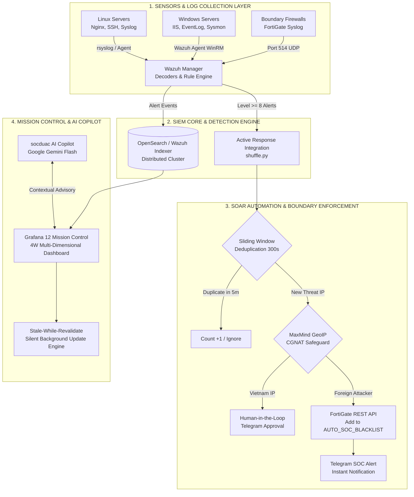

# KIẾN TRÚC TỔNG THỂ HỆ THỐNG WAZUH SIEM & SOAR AUTOMATION

Tài liệu mô tả kiến trúc kỹ thuật 4 lớp (Multi-Tier Defense Architecture) của trung tâm giám sát và tự động phản ứng sự cố an toàn thông tin (SOC SIEM / SOAR).

---

## 1. SƠ ĐỒ LUỒNG DỮ LIỆU TÁC CHIẾN (END-TO-END FLOW)

---

## 2. PHÂN TÍCH CHI TIẾT CÁC LỚP BẢO VỆ

### Lớp 1: Thu thập nhật ký & Cảm biến giám sát (Sensors & Log Collection)
* Hỗ trợ đa nền tảng: Linux (Ubuntu, Debian, CentOS), Windows Server (IIS 8.5/10), thiết bị mạng tường lửa (FortiGate, Cisco).
* Thu thập chuyên sâu:
  - **Sysmon (System Monitor):** Giám sát Process Creation (Event 4688 với dòng lệnh chi tiết), Image Loading (Event 7 kiểm tra chữ ký số DLL), Network Connection (Event 3).
  - **Web Access Logs:** Phân tích thời gian thực request log Nginx, Apache và W3C Format trên IIS.
  - **FIM Phân tầng (Tiered Integrity):** Giám sát tính toàn vẹn tệp tin có chọn lọc bằng cờ `restrict` để ngăn chặn bão hòa dung lượng (Rule 233).

### Lớp 2: Lõi phân tích & Luật phát hiện (Detection Engineering)
* Phân tích tương quan sự kiện với hơn 70.000 dòng luật tùy biến.
* Mô hình phân loại 6 nhóm nguy cơ (**CAT1 - CAT6**) ánh xạ chuẩn MITRE ATT&CK.
* Ghi dữ liệu thời gian thực vào OpenSearch/Elasticsearch cluster phân tán.

### Lớp 3: Tự động hóa phản ứng biên (SOAR & Boundary Defense)
* **Khử trùng lặp cửa sổ trượt (Sliding Window Deduplication 300s):**
  - Sử dụng SQLite WAL cục bộ với khóa kép `(src_ip, rule_id)`.
  - Triệt tiêu 95% lưu lượng cảnh báo trùng lặp khi kẻ tấn công thực hiện dội bom yêu cầu (Flooding).
* **Bảo vệ IP nội địa (CGNAT Safeguard):**
  - Tích hợp MaxMind GeoLite2 City & ASN database.
  - Phân tách tuyệt đối giữa IP nước ngoài và IP trong nước, đảm bảo không bao giờ tự động chặn nhầm các dải CGNAT của nhà mạng 4G Viettel, VNPT, FPT.
* **Mô hình Thực thi Kép (Hybrid Dual-Track Enforcement):**
  - **Kênh tức thì (REST API <0.5s):** Đưa IP vào Address Group `WZ_AR_BLOCKLIST` trên cụm FortiGate để ngắt kết nối phiên tấn công đang diễn ra.
  - **Kênh tình báo dài hạn (External Threat Feed URL):** Sinh danh sách `vnu_soc_blocklist.txt` chuẩn RFC, cho phép FortiGate tải trực tiếp vào RAM, giữ file cấu hình tường lửa luôn gọn gàng.
* **Quản lý Vòng đời IP Aging 30 ngày (Anti-Bloat Lifecycle):**
  - Cơ chế tự động giải phóng các IP sau 30 ngày im lặng; tự động gia hạn thêm 30 ngày nếu phát hiện tiếp tục có hành vi xâm nhập.
  - Bảng `feed_history` bảo toàn 100% dữ liệu lịch sử phục vụ điều tra hồi cứu và chứng minh pháp lý.
  - Nút dừng khẩn cấp (Emergency Kill-Switch / Flush) phản hồi dưới 1ms cho phép SOC trực ban giải phóng toàn bộ dải cấm khi có sự cố.

### Lớp 4: Trực quan hóa & Trợ lý ảo AI (Mission Control & AI Copilot)
* **Mô hình chu trình điều tra 4W:**
  - **Who:** Kẻ tấn công là ai? (Top IP Nguồn, Quốc gia, ASN).
  - **Where:** Máy chủ nào bị tấn công? (Top Wazuh Agent).
  - **Which Service:** Cổng dịch vụ / Domain nào bị nhắm tới? (HTTP, SSH, RDP).
  - **What Action:** Đe dọa là gì và chế tài xử lý ra sao? (Phân loại CAT1-CAT6, Drop/Deny).
* **Động cơ Silent Background Update:**
  - Vô hiệu hóa chớp nháy và thanh loading xoay tròn, giữ ổn định 100% bố cục trang hiển thị trên SOC Wall.
* **AI Copilot (socduac / ChatBotDUAC):**
  - Trợ lý AI đàm thoại đa lượt (Google Gemini Flash).
  - Thiết lập nghiêm ngặt: **Strict Read-Only & Zero-Mutation** (Chỉ đọc log & cố vấn tham mưu, không tự ý thay đổi hạ tầng).
